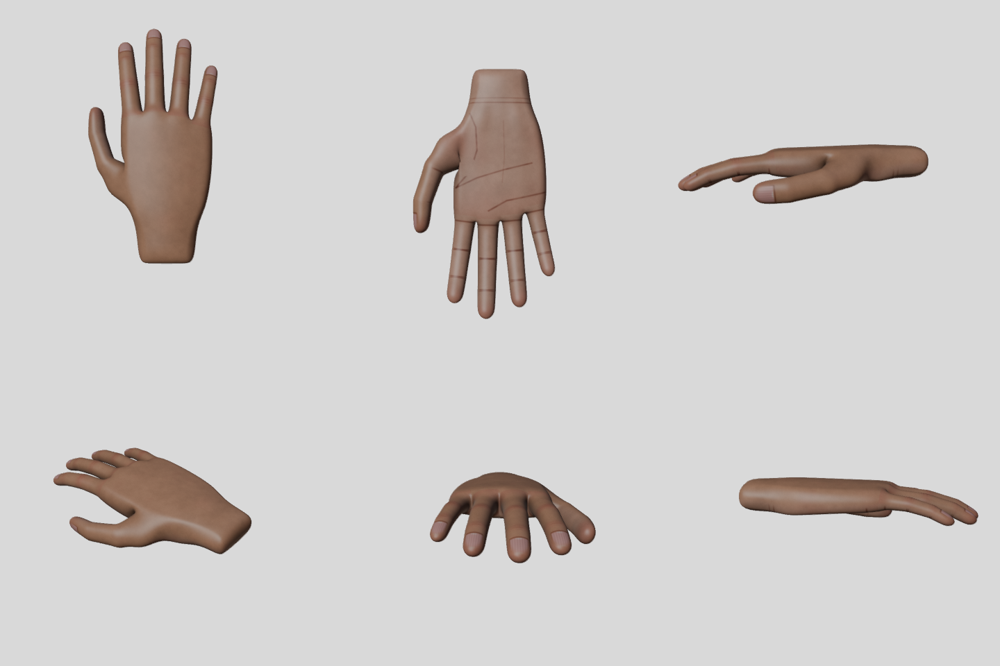
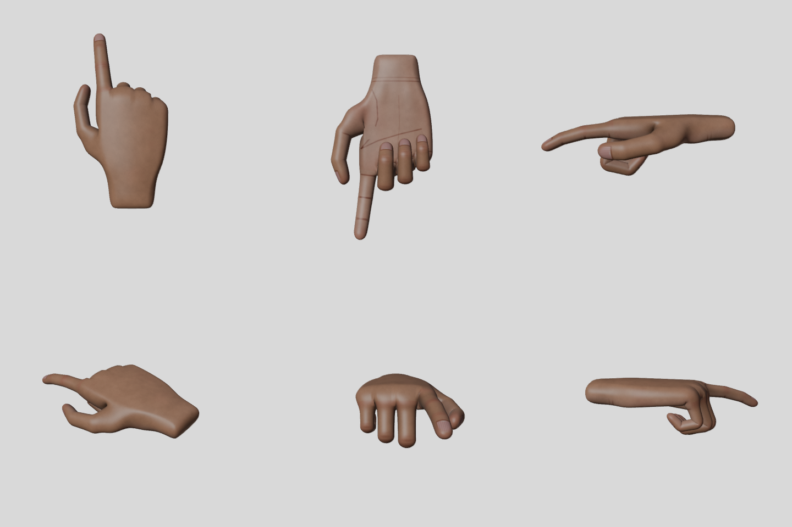
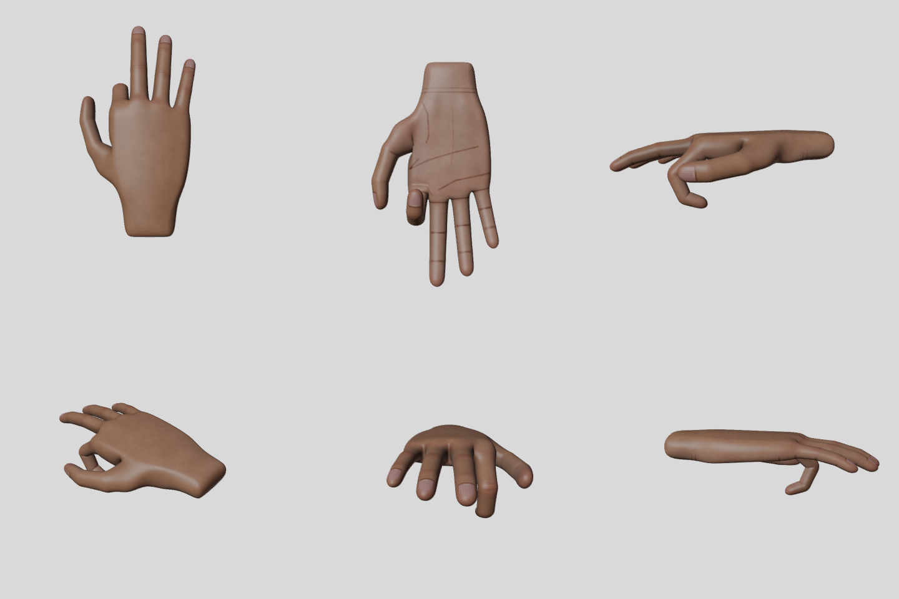

# Lab 03 – VR Hands (Blender → Unity XR)

Demo video: [`VRHands-Demo.mp4`](VRHands-Demo.mp4)

| Folder | Contents |
|---|---|
| [`Blender`](Blender) | `Hand.blend`, exported `Hand.fbx`, textures, preview renders and the Python scripts that build everything |
| [`VRHands`](VRHands) | Unity **6000.3.25f1** project (built on the Lab 02 darts project). Scene: `Assets/Scenes/HandsScene.unity` |

## 1. Modelling the hand (Blender 5.1)

The hand is box-modelled in [`build_hand.py`](Blender/build_hand.py), which runs headless with `blender -b --factory-startup -P build_hand.py`:

* **Palm:** a quad box (8 × 5 × 2 segments) shaped like a real palm. It is about 8.5 cm wide and 10 cm long, with a dorsal arch, thenar and hypothenar pads, a curved knuckle line and a narrower wrist.
* **Five fingers:** index, middle, ring and little fingers are extruded from the top of the palm, and the thumb from the side of the palm. Each one is a chain of 12 edge rings placed on an ellipse along a skeleton with three phalanges. There are extra loops at every joint (for good deformation), a slight rest curl, a natural spread, a flattened nail area and a rounded tip. The thumb rolls about 60° so its pad faces the fingers.
* A short wrist stub is added, then a **Subdivision Surface** (level 2) is applied. The result is a closed, manifold, all-quad mesh with **10,434 vertices and 20,864 triangles**.

## 2. UV unwrap and texture

* **Seams** run along the side of the hand and of every finger (the "glove" cut that separates palm from back), plus a ring around each finger base. This gives **12 islands**, unwrapped with Blender's *Minimum Stretch* method and packed (63% of UV space used).
* The distortion is measured in the script. The mean angle distortion (σ₁/σ₂) is **1.035** and 95% of the surface stays under 1.10. **99.8% of the surface keeps its area within ±25%.** On the UV checker the squares stay square everywhere ([render](Blender/previews/checker_sheet.png)).
* **Texture** [`Hand_Albedo.png`](Blender/textures/Hand_Albedo.png) (2048 px) is generated in three steps:
  1. Cycles bakes the surface position, normal and AO into UV space.
  2. Each texel is painted from its 3D position. Because of this, the colour is continuous across every seam.
  3. The paint layers are: back/palm skin tones, warmer fingertips and knuckles, 3D noise mottling and pores, fingernails (with lunula and free edge), joint creases, knuckle wrinkles, palm lines and wrist lines, and softened AO.
* [`Hand_UV_Layout.png`](Blender/textures/Hand_UV_Layout.png) shows the UV wireframe over the texture.

## 3. Rig, animations and FBX export

* **Armature `HandRig`** has 16 bones: `Hand` plus 3 bones per finger (`Thumb_1..3`, `Index_1..3`, …). Each bone's roll is set so that local X is the flexion axis. Skin weights are computed per vertex from the finger skeleton, with rigid phalanges and smooth blends across each joint.
* **Actions** (exported as FBX takes):

  | Clip | What moves |
  |---|---|
  | `Idle` | relaxed rest pose |
  | `Grip` | middle, ring and little fingers curl (plus a slight thumb curl) |
  | `Trigger` | index finger curls |
  | `Fist` | Grip + Trigger, with the thumb closing over |

* `Hand.fbx` is exported with `-Z forward / Y up`, unit scale applied, no leaf bones, and all actions.

## 4. Unity integration

Everything is scripted in [`Assets/Editor/VRHandsSetup.cs`](VRHands/Assets/Editor/VRHandsSetup.cs). The menu **VR Hands → Setup Everything** does all of the following:

1. Configures the importer for `Hand.fbx`: Generic rig, axis conversion baked, four clips (`Idle`, `Grip`, `Trigger`, `Fist`).
2. Creates `Hand_Skin.mat` (Standard shader + albedo).
3. Creates `Hand.controller`, an Animator with a **2D Freeform Cartesian blend tree**:
   - `Grip` on X, `Trigger` on Y.
   - Corners: Idle (0,0), Grip (1,0), Trigger (0,1), Fist (1,1).
   - Analog controller values therefore blend the poses continuously.
4. Creates the prefabs `Right Hand` and `Left Hand`. They use the same model, and **the left hand is mirrored with scale x = −1**. An `Offset` child aligns the hand to the controller: fingers forward, palm against the grip.
5. Builds `HandsScene` from the Lab 02 darts scene (XR Origin + XR Interaction Toolkit 3.3.2 + OpenXR):
   - Hides `Left/Right Controller Visual`.
   - Attaches the hands as children of `Left Controller` / `Right Controller`.

[`HandAnimatorInput.cs`](VRHands/Assets/Scripts/HandAnimatorInput.cs) reads the XRI input actions every frame and passes them to the Animator, with light smoothing:

| Hand | Animator `Grip` | Animator `Trigger` |
|---|---|---|
| Left | `XRI Left Interaction/Select Value` (grip) | `XRI Left Interaction/Activate Value` (trigger) |
| Right | `XRI Right Interaction/Select Value` | `XRI Right Interaction/Activate Value` |

Grabbing still uses the normal XRI Near-Far interactors, so the hand closes on a dart while you hold it (darts, board and scoring come from Lab 02).

### Extras

* A **Hand Input** world-space panel ([`HandInputPanel.cs`](VRHands/Assets/Scripts/HandInputPanel.cs)) shows the live grip/trigger value of each hand as bars.
* The hands and the darts game work together: pick up darts with the animated hand and throw them for points.
* The whole asset pipeline is reproducible from scripts: modelling, UVs, texture, rig, animation and export in Blender, and the import, animator, prefabs and scene in Unity.

## 5. Testing

* **With a headset:** connect it via Link/SteamVR (OpenXR) and press Play. Squeeze the grip to curl three fingers and pull the trigger to curl the index finger.
* **Without a headset:** the scene keeps the XR Device Simulator.
  - **G** = grip, **left mouse** = trigger.
  - Hold **Space** / **Left Shift** to move the right / left controller.
  - Hold **right mouse** to look around.

## 6. Demo video

The video shows the hands in use inside Unity. It is recorded by a play-mode test, [`Assets/Tests/DemoRecorder.cs`](VRHands/Assets/Tests/DemoRecorder.cs):

* It replaces the simulator with scripted XR HMD/controller devices.
* It feeds the **same input actions** a headset would use: poses, grip and trigger.
* It saves a frame every 1/30 s.

[`make_video.py`](Blender/make_video.py) encodes the frames, with captions, into an MP4 using Blender's video sequencer.
